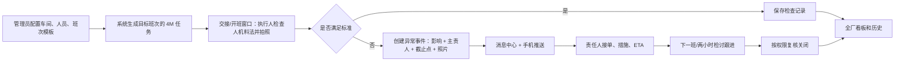

# DM 工厂日常管理系统：现场运行与交付方案

版本：1.0（现场流程和首个可交付版本边界）  
适用范围：泰国工厂；6 个车间及生产、物流、设备、质量、工程等职能部门；预计 DM 用户少于 100 人。

这份方案把现场制度、手机操作、跨部门协同、提醒、权限、数据同步、安装和上线条件放在同一条链路上。它优先解决 4M 开班准备、两小时检讨和异常闭环；LOSS 台账暂不进入首批上线。

## 1. 设计原则

1. **先看下一班能不能顺利开线。** 4M 点检记录的是对目标班次的人员、设备、物料、方法准备，不是为了多做一张打卡表。
2. **一条异常只有一个主责人。** 可添加协作部门和协作人，但不能用群聊、@ 或“大家都知道了”替代责任人。
3. **提醒不等于收到，收到不等于接单。** 只有责任人在 DM 内确认接单才开始计算已响应。
4. **系统以风险事件为中心协同。** 评论、照片、措施、ETA、交接、复核和关闭历史都挂在同一事件上；不另造一个没有闭环状态的泛聊天区。
5. **手机现场操作短、默认值明确。** 正常检查快速提交；只有异常时才展开责任、影响和处理时限字段。
6. **中文和泰文同等完整。** 面向泰国现场操作人员默认使用泰文；主管可以切换中文。关键动作同时用文字、图标和状态，不靠颜色单独表达。
7. **跨设备数据只有在服务端确认后才算共享。** 弱网本地暂存必须标为“待同步”；未同步的记录不能进入全厂排名或冒充已通知。

## 2. 现场人员与权限

权限按“岗位角色 + 组织范围”判定，首版只有三类常用角色：

| 角色 | 现场岗位示例 | 默认可做事项 |
|---|---|---|
| 工厂管理员 | 工厂管理 / 系统负责人 | 配置组织、人员、班次、4M 模板、会议日程、责任路由；查看全厂；管理账号 |
| 区域负责人 | 车间负责人、物流/设备/质量/工程负责人 | 查看所属车间或职能范围；接收升级；复核、转派和关闭授权范围内事项 |
| 执行人 | 班组长、点检执行人、部门值班人 | 完成本人的班次任务；创建异常；接单、反馈措施、申请交接 |

一个人可以兼任多个范围或角色。人员目录里至少要有：员工 ID、显示姓名（中文或泰文）、首选语言、所属部门/车间、岗位角色、可接收责任的范围、在职状态。责任人选择必须来自有效人员目录；不得要求泰国一线员工手打不熟悉的姓名或任意搜索全厂员工。

**账号方案：** 管理员批量导入用户并分配组织范围；员工用员工 ID 和初始 PIN/密码首次登录后修改凭据，系统保留本机登录状态。账号初始化、找回和停用由管理员处理。若现场已有公司身份平台，再接入公司 SSO；不要让用户创建个人邮箱作为工厂的唯一账号。

## 3. 每个生产日的运行节拍

班次窗口和工作日以工厂配置为准，应用不把 7:40、8:00 或任何会议时间硬写进代码。车间模板决定谁在什么时间做哪项准备。



### 3.1 4M 开班准备

1. 员工登录后默认进入已分配车间/部门和目标班次，不需要每天重新选组织。若在交接窗口提前为下一班检查，任务明确标成“下一班准备”，记录保存到目标班次，而不是按拍照时钟错误地算到上一班。
2. 点检首页只展示需要做的人、机、料、法四类任务，并显示目标班次、截止时间和进度；每类车间检查项来自后台模板，按车间配置，不把所有车间的表单强行统一。
3. 每个任务按模板填写状态并拍照留证。人员照片可用于出勤/请假表；设备、物料、方法拍设备、实物、单据或工装现场。首版的照片规则由管理员模板配置，产品不固定写死所有车间都同一套子项。
4. **正常**：选择“正常”并拍照提交。系统记录执行人、检查时间、目标班次、模板版本和证据。
5. **异常/预警**：出现异常后再展开四个简单字段：影响什么车间/产线/型号、谁是主责人、紧急程度/期限、现场照片。主责部门和人员使用可搜索的泰文/中文名册。发起人不用写长篇报告；缺料可填零件号、可用量、预计断料时间，设备问题填设备/影响线体/预计恢复。
6. 同一目标班次、同一模板项目只生成一个有效点检任务。重拍或更正以新修订保存，保留原记录和修订人；不能重复点按制造虚假的完成数。
7. 离线时记录进入本机待同步队列，显示待同步标记；照片和记录上传成功后才作为全厂已完成。重复重试使用同一请求 ID，避免弱网造成重复任务。

### 3.2 两小时检讨会议

- 每个生产日按工厂计划为每个参会范围生成上午、下午各一场会议打卡。不是每两个小时生成一项检查，也不按白夜班重复计数。
- 执行人打开当前场次，选择“已召开 / 未召开”并拍会议现场照片；未召开必须填写简短原因。
- 未召开生成一条会议跟进事件，派给该场会议的组织负责人。会议可以引用未关闭的跨部门异常；会议决定（例如换型号生产、补料时间、设备恢复 ETA）写回原异常，不抄成第二个互相独立的任务。
- 会议时间、参会范围、组织人、有效工作日由管理员配置；本厂实际时点以正式配置为准。

## 4. 异常协同与责任闭环

### 4.1 责任分派规则

- 一名**主责人**对下一步动作和 ETA 负责；可添加协作岗位/人，但关闭前主责人必须明确。
- 若发起人不能判断由谁处理，按异常类型和受影响车间路由到值班岗位（例如缺料 → 物流值班；设备停机 → 设备值班）。值班人接单后必须落实到一名具体员工。
- `@` 是事件里的协作提醒动作，不是任意群聊，也不替代主责分派。
- 跨部门例子：仓库发现下一班某型号缺料 → 录入零件/数量/断料时点和受影响车间 → 指派物流主责人，并协作通知生产计划和车间负责人 → 物流填补料 ETA → 生产计划记录是否调序及生效班次 → 接班负责人确认安排 → 到料/切换后由授权岗位复核关闭。

### 4.2 状态机

`待接单 → 已接单 → 处理中 → 待复核 → 已关闭`

- 责任人可以把“待接单”转派给下一名具体责任人，原主责人、接收人和转派理由进入时间线。
- 处理未完成但跨班时，进入“跨班待接手”；保留当前临时措施、风险、主责人、ETA、影响班次，并在下一班首页和交接清单置顶。
- 复核不通过则退回“处理中”；复核通过由有权限的区域负责人关闭。任何用户不能靠关闭聊天或通知把事件关掉。
- 事件创建、接单、转派、措施、ETA 更改、交接、复核、关闭都写入不可覆盖的审计历史。

### 4.3 紧急程度和升级

| 等级 | 适用情形 | 首次责任 | 未接单后的处理 |
|---|---|---|---|
| 立即 | 可能影响安全、质量放行、当前停线或重大生产中断 | 立即推给主责和值班负责人；页面同时提示按厂内规则电话/当面联系 | 短时限后升级车间负责人/工厂值班人；不等待下一次例会 |
| 开班前 | 可能影响下一班开线、目标型号、计划产量或交期 | 指派主责并设置开班决策截止点 | 截止前仍无人接单时提醒责任部门负责人，并列入开班/检讨清单 |
| 跟进 | 当前有临时措施、不阻断开班，但需继续处理 | 设置跟进责任人和复核时间 | 逾期升级区域负责人，并在下一次两小时检讨呈现 |

默认时间按工厂班次配置；不要让现场员工输入复杂日期。系统提供“立即 / 开班前 / 下一次检讨前 / 自选时间”简单选项，负责人可补充精确 ETA。

## 5. 消息、推送和微信兜底

消息中心是统一的“待办”，只放需要某人执行的事件：**待我接单、处理中、待我复核、已处理**。通知写入服务端收件箱后，即使 OS 推送失败，用户下次打开 DM 仍能看到。

- Android APK 和 iOS 原生 App 使用同一个 Expo Notifications 客户端接口；服务端将推送交由 Expo 推送服务转发至 Android FCM 或 Apple APNs。Firebase Firestore 仍作为跨端业务记录的唯一底账。
- iOS 不把“添加到主屏幕网页”作为正式工厂安装方案。生产分发优先采用 **App Store 非公开（Unlisted）直链**：员工点统一安装页上的 App Store 链接，按普通 App 安装；首次打开登录后，系统在用户点击“开启工作提醒”时请求一次通知授权。不会要求每人先用 Safari 加主屏幕。
- 推送内容只含事件编号、范围、简要影响和 DM 深链，不把个人照片/敏感长文本放在锁屏。点击后进入事件详情并要求登录。
- 服务端记录“已排队/推送服务已接受/失败”，不伪称手机已收到。消息已读也不等于接单；接单状态只能由用户在 DM 里确认。
- 未接单依靠服务端截止时间升级，不依赖原手机是否弹窗。高风险事项仍须用工厂已有电话/当面机制；DM 提供双语分享摘要和链接，员工可主动转到微信。微信副本不视为接单，接收人需要回 DM 确认。
- 在主管首页展示提醒授权状态和最后同步时间；权限关闭或推送 token 失效时提示管理员和用户，但待办仍留在收件箱。

Expo 的推送 SDK 已覆盖 iOS/Android 的令牌、收发和点击跳转；Android 需要 FCM 服务凭据，iOS 需要 APNs/EAS 签名配置。开发预览不能代替真实签名安装后的实体机推送验证。

## 6. 安装与发布：一步安装入口

统一网页提供两个按钮：**Android 安装**、**iPhone 安装**。Android 生产版可用 Google Play 内部/封闭轨道或受管私有应用；当前 APK 链接是演示渠道，若直接侧载，Android 会有一次“允许此来源安装”的安全提示。需要做到最少弹窗时，选择正式应用商店或受管设备渠道。

### iPhone 主路线：非公开 App Store 链接

非公开 App 不出现在 App Store 搜索、分类和榜单中，用户通过直链进入 App Store 安装；它仍按正常 App Store 流程审核。链接可以被转发，所以**应用内登录和服务端权限才是数据安全边界**，不能把链接本身当作安全控制。用户无需安装 TestFlight，也无需手动信任企业证书。

需要：组织 Apple Developer Program / App Store Connect 账号、合法实体资料（组织账号需 Apple 要求的验证信息）、Bundle ID、App 隐私/审核材料、签名凭据、正式构建、App Review 和非公开分发申请。当前 Expo 项目可用 EAS Build 从云端产出 iOS/Android 二进制，不要求开发者本地有 Mac；发布账号和苹果审核仍需组织方配合。

### 需要严格限定给特定组织时

改为 Apple Business 自定义 App；应用只对指定 Apple Business/Apple School Manager 组织可见。若工厂已用 MDM，可分配后自动安装；若没有 MDM，账号/授权和用户安装会多几个步骤。先确认 IT 现状，再决定是否值得增加这套设备管理。

Apple Developer Enterprise Program 不是绕开审核的通用侧载方案；Apple 规定它用于确实不能由 App Store、Apple Business、Ad Hoc 或 TestFlight 满足的内部场景，申请组织需至少 100 名员工并通过审核。**少于 100 名 App 用户不等于少于 100 名公司员工**；资格看组织本身，并且还要满足其它条件。TestFlight 适合试点，单个 build 最多测试 90 天，不用于长期安装。

### 推送正式启用前的员工动作

1. 从统一网页点对应平台的安装按钮。
2. 登录工厂账号（由管理员预先开通，不由员工填一堆设置）。
3. DM 用泰文说明用途，员工点“开启工作提醒”一次，接受系统通知权限。
4. 完成一条带照片的试点点检，主管验证另一台手机同步、异常接单、升级和复核。

后续组织/班次/语言等从员工目录下发；用户不再手工选部门、权限层级或会议时点。

## 7. 首页与管理指标

首页默认全厂视角，支持日/周/月；车间/部门榜与执行人榜分别查看 4M 和两小时检讨完成率。每条显示完成数/计划数，排名只在适用计划已配置且数据已同步后计算。

- 4M 完成率 = 目标周期按时同步完成的计划任务 ÷ 该周期已到期的计划任务。
- 会议完成率 = 记录“已召开”的计划场次 ÷ 该周期应开的上午/下午场次；未召开和未记录分开展示。
- 执行人排名按“分配给此人的有效任务”作分母；不得把车间任务平均摊给所有员工。
- 无有效计划时显示“未配置”，不显示 0% 或参加排名；待同步记录不计入已完成，重复修订不重复计数。
- 首页首屏先显示需要处理的立即/开班前事件和下一班风险，再显示完成率榜。排名用于发现支持需求，不能把人员榜单本身当成唯一绩效评价。
- 现场问题关闭和安全/质量确认按既有授权流程执行；DM 不自动决定停线、放行或型号调序。

## 8. 数据与系统架构

```text
Expo / React Native App (iOS + Android)
  ├─ Presentation: src/app, src/ui
  ├─ Domain: 4M, meeting, assignments, issue state machine, ranking rules
  ├─ Application state: current user, cached tasks, pending sync
  ├─ Repository port: inspection / meeting / issue / directory / schedule
  └─ Adapters: local prototype → Firebase Auth / Firestore / Storage

Firebase
  ├─ Auth: user identity and session
  ├─ Firestore: organization, directory, templates, schedules, task records,
  │             issues, comments, inbox, audit history, device registrations
  ├─ Storage: compressed evidence photos with organization-scoped paths
  └─ Cloud Functions: assignment routing, deadlines, escalation, push dispatch,
                     metric materialization and audit validation

Push adapter
  ├─ Android: Expo push token → Expo Push Service → FCM
  └─ iOS native: Expo push token → Expo Push Service → APNs
```

建议的 Firestore 业务集合：`organizations`、`users`、`areas`、`shiftSchedules`、`inspectionTemplates`、`assignments`、`inspectionRecords`、`meetingSchedules`、`issues`、`issueEvents`、`inbox`、`deviceRegistrations`。照片先压缩再上传；数据库只存带权限校验的对象路径，不把大图塞进记录文档。

**数据规则：** 记录以组织 + 车间/部门 + 目标日期/班次/模板项唯一；事件以来源记录 ID 唯一；服务端校验角色范围和状态转换；照片路径绑定组织和记录；账号停用后撤销 token；关键字段更改保留审计事件。Firestore 读写权限不能只靠前端隐藏按钮。

**离线和弱网：** 本地 outbox 保存记录与待上传照片；同步成功后回写服务器 ID 和最后同步时间；相同 `clientMutationId` 重试不重复创建；冲突记录提示主管处理，不静默覆盖。排名以服务端确认数据为准。

## 9. 现阶段实现范围与生产验收门槛

本分支把可在当前代码库独立完成的端到端手机流程先实现：中泰操作界面、4M/会议记录、异常责任字段、应用内待办/状态闭环、事件分享摘要、统一分发入口和发布配置说明。没有 Firebase 项目配置时，本地演示仍明确标为本机数据；不假装已实现多设备通知或实时排名。

要由演示转为全厂生产使用，必须先完成以下现场配置和真实设备验收：

1. 工厂确认正式车间/部门、班次时间、工作日历、会议计划、每个车间的 4M 项目模板和拍照规则。
2. 管理员导入真实员工及岗位责任名册，确定员工账号初始化与离职停用机制。
3. 确认 Firebase 项目归属/区域、数据保留政策、管理员；配置 Firestore/Storage 安全规则、测试与生产环境、备份。
4. 配置 Expo/EAS 项目、Android FCM、iOS APNs、签名和应用图标/隐私文案。
5. Apple Developer/App Store Connect 账号完成组织验证、首次审核和非公开链接申请；Google Play/内部分发路径与 APK 签名落实。
6. 在现场网络下用真实 Android 和 iPhone 验证：开班照片提交、弱网待同步、跨账号共享、主管接单/转派/跨班交接、锁屏推送点击深链、未授权推送升级、复核退回/关闭、数据范围权限和员工离职停用。

只有这些验收通过，才把首页从“演示/待同步”切换成“全厂实际数据”。

## 10. 发布参考

- [Apple 非公开 App 分发](https://developer.apple.com/support/unlisted-app-distribution)：直链安装；不在搜索/榜单中；仍需 App Review；任何取得链接的人可访问，因此 App 内必须鉴权。
- [Apple 自定义 App](https://support.apple.com/guide/deployment/distribute-custom-apps-dep0113f6e18/1/web/1.0)：通过 Apple Business/Apple School Manager 私下分发到指定组织。
- [Apple Enterprise Program 资格](https://developer.apple.com/programs/enterprise/)：只用于其它正规分发不适用的内部用例；要求组织至少 100 名员工及资格审核。
- [Apple TestFlight](https://developer.apple.com/help/app-store-connect/test-a-beta-version/testflight-overview/)：用于 Beta；单个 build 可测试 90 天。
- [Expo SDK 58 Notifications](https://docs.expo.dev/versions/v58.0.0/sdk/notifications/)：按当前项目 Expo SDK 58 查阅；原生 push 使用设备/Expo token、配置插件和推送凭据。
- [Expo 构建与提交](https://docs.expo.dev/deploy/build-project/) 和 [提交到应用商店](https://docs.expo.dev/deploy/submit-to-app-stores/)：云端产物和上传流程。
