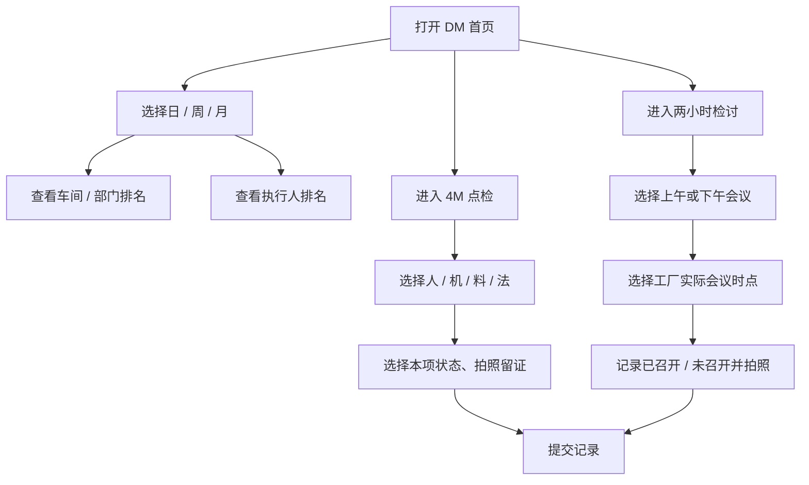

# DM 日常管理 App：产品与代码架构初稿

版本：原型 0.2  
范围：全厂总览、4M 点检、两小时检讨会议、记录与安装入口。LOSS 台账暂缓。

## 1. 要解决的现场问题

工厂管理者需要在同一处看清各车间和部门的 4M 点检、两小时检讨会议是否按计划完成；现场执行人需要能快速选择本班任务、拍照留证并提交。管理者还需要按日、周、月查看车间和执行人的完成情况，以便安排支持和跟进。

## 2. 用户与权限

| 角色 | 典型岗位 | 首版职责 |
| --- | --- | --- |
| 工厂管理员 | 工厂管理、系统管理员 | 配置组织、人员、模板、会议时间和角色；查看全厂数据 |
| 车间 / 部门负责人 | 车间经理、部门负责人 | 查看本范围排名和记录；跟进未完成项；维护本范围执行人 |
| 执行人 | 班组长、点检执行人 | 完成本班 4M 点检和会议打卡；查看本人记录 |

首版不拆成四级或更多权限。车间负责人可兼部门负责人，具体数据范围由所属组织决定。原型当前没有登录和服务端授权，权限表是后续 Firebase 阶段的设计边界。

## 3. 主流程



## 4. 首页与指标口径

首页定位为工厂级管理看板，不锁定当前车间。榜单支持日、周、月切换，并分别查看 4M 点检和两小时检讨会议。每个车间 / 部门行显示选中指标的完成率、已完成数 / 计划数，以及另一指标的完成数，切换指标后排名顺序相应更新。执行人榜使用相同周期和指标筛选，可展开查看完整名单。

| 指标 | 计算口径 | 首版显示 |
| --- | --- | --- |
| 4M 点检完成率 | 周期内已提交的计划点检项 ÷ 周期内应完成的计划点检项 | 车间 / 部门与执行人分别排名 |
| 两小时检讨完成率 | 记录为“已召开”的会议场次 ÷ 该周期应开的会议场次 | 上午、下午各一场；明确区分已召开、未召开、未记录 |
| 执行人完成率 | 执行人已提交的分配任务 ÷ 分配给该执行人的任务 | 按当前查看的 4M 或会议指标单独排名 |
| 工厂总体完成率 | 全厂已完成计划项之和 ÷ 全厂计划项之和 | 按计划项数加权，不对车间百分比做简单平均 |

没有计划数的对象显示“—”，不按 0% 排名。实际分母必须由工作日、班次、车间模板和人员任务配置产生，不能用固定的“每人每天 4 项”替代正式配置。

## 5. 现场业务规则

### 4M 点检

- 分类固定为人员、设备、物料、方法；不同车间可配置各自的具体项目。
- 首版原型给每类准备少量选择项：人员出勤、设备状态、物料齐套、作业标准 / 工装准备；这些是演示选项，之后按车间标准替换。
- 设备、物料、方法类必须上传照片；人员类可以不拍照，也可上传出勤表或请假表。
- 正常 / 异常与具体选择项分开记录；异常需要填写说明。

### 两小时检讨会议

- 语义是生产状况检讨会议的打卡记录，不是每两个小时自动生成一次现场检查任务。
- 每个生产日、每个车间 / 部门按上午、下午各一场排程，合计两场，不按白班 / 夜班重复加倍。默认原型时间为 10:30 和 14:00；上午可选 10:00 / 10:30，下午可选 14:00 / 15:00。
- 每场会议记录“已召开”或“未召开”，两者都需要照片作为现场凭证；未召开需说明原因。
- 会议时间选择属于排程配置，生产环境应由授权管理员设置，普通执行人只能选择场次并提交记录。

### 记录与异常闭环

- 点检记录保留组织、执行人、班次、任务、状态、照片、备注和提交时间。
- 当前原型只保存本机数据；设备间同步、组织任务分配、主管审核及异常升级需要接入统一后端。
- LOSS 台账不进入首版范围；可在后续版本加入异常升级、责任人、期限和关闭证据。

## 6. 首版代码分层

```text
src/app/             页面与导航：全厂首页、点检入口、4M 分类、会议、记录、设置、完整排名
src/ui/              可复用卡片、照片字段、打卡表单和排名行
src/domain/          4M / 会议领域模型、指标口径、周期筛选、双语文案
src/state/           当前登录上下文的原型状态容器
src/data/            本地存储、照片选择；后续替换或扩展为 Firebase 数据适配器
site/                安装说明页及 Android / iOS 入口
```

运行时使用 Expo + React Native + TypeScript。一份业务界面代码同时构建 Android、iOS 和网页预览。Firebase 接入后，两种手机系统写入同一套用户、组织、任务、会议记录和照片数据：Authentication 管身份，Firestore 存组织与记录，Storage 存照片。UI 通过 repository 读写数据，不直接依赖 Firebase SDK，便于保持本地演示和线上数据实现可替换。

建议的 Firebase 业务集合：`organizations`、`users`、`workshops`、`inspectionTemplates`、`assignments`、`meetingSchedules`、`checkRecords`。照片使用按组织 / 日期 / 记录 ID 分区的 Storage 路径。正式上线需配置基于角色和组织范围的 Firestore、Storage 安全规则。

## 7. 安装与发布

- Android：通过 EAS 生成签名 APK，并从 GitHub Release 下载；官网安装页读取最新 APK 链接。
- iPhone：当前可由网页“添加到主屏幕”安装体验，但它不是原生 iOS 安装包；原生 App Store / TestFlight 发布需要 Apple 开发者签名账号。
- 两个客户端都访问同一个后端项目和数据规则，不能各自保存互不相通的数据。

## 8. 本次原型的真实边界

- 首页排名由显式标记的样例数据展示，帮助评审布局和筛选流程；不代表工厂真实表现。
- 点检和会议表单把记录保存在当前设备；Firebase 项目凭据尚未配置，跨设备实时同步尚未实现。
- `PRO1`–`PRO6`、`PE`、`IP`、`QA`、`PC` 是原型组织代码；应在组织配置阶段换成工厂正式名称。
- 当前初始角色为工厂管理员、车间 / 部门负责人、执行人；原型暂未接入账号与角色控制。

## 9. 验收标准

1. 首页默认进入全厂总览，不显示为单个车间首页。
2. 日、周、月切换后，车间榜与人员榜的区间、计划分母和百分比同步切换。
3. 4M 与会议排名可独立选择；所有 4M 类别都提供实际可点选的项目，人员照片可选，其余 4M 照片必需。
4. 两小时检讨只出现上午和下午两场；会议时间可在用户给出的时点中选择，未召开必须说明并拍照。
5. 中文与泰文文案覆盖主要页面、状态、筛选、异常提示和下载说明。
6. 所有样例排名明确标注“演示数据”，不得伪装成实时结果。

## 10. 参考来源

- 工厂资料：`日常管理V2.0版5.8(融合DMS4.0版本).pdf`，重点参考第 13、20、28–36、54–58 页的日常管理、分层会议、时间配置示例和 4M 管理流程；第 54 页的时间仅作课件示例，本厂排程以用户提供时点为准。
- 工厂资料：`MBS-日常管理4.0（修订）.pptx`，重点参考第 37–38、46、60–62 页的问题处理、目标与责任、分层看板和排名设计。
- 产品方法参考：`bmad-agent-pm` 与 `manufacturing-expert` 的公开 Skills 描述。只采用与本产品相关的用户需求拆解、可度量指标和制造业系统边界，不照搬通用制造系统功能。
