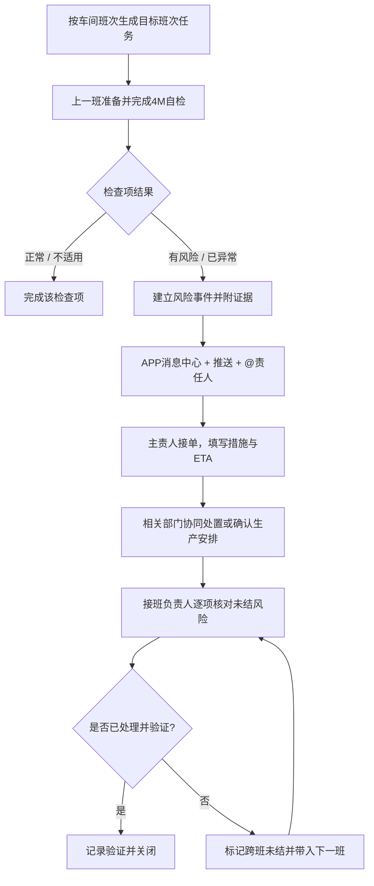

# DM 系统产品逻辑 v0.3

> 状态：产品逻辑方案，供后续页面与代码开发使用；本稿不代表已经实现。

## 1. 产品目标与范围

DM APP 的首要目标是把现有纸质自检、班次交接、两小时检讨会议和历史查询搬到手机上，减少填写与追问时间，并让交接风险能够找到责任人、及时处置、跨班次追踪。

首版业务范围：

1. 全厂总览：查看车间 / 部门和执行人的 4M 自检及两小时检讨执行情况。
2. 4M 自检：按本班或下一班的生产准备场景，检查人、机、料、法的准备状态。
3. 风险预警与协同：异常关联到受影响的班次、产品、区域和责任人，支持 @、接单、处置、交班和关闭。
4. 两小时检讨会议：记录会议是否召开、会议证据与决议；自动带入未关闭的 4M 风险。
5. 历史记录：查找自检、预警、处置、交接、会议和附件。
6. 组织配置：维护车间 / 部门、班次、纸质检查项、排程和责任人路由。

LOSS 台账继续暂缓。

## 2. 术语与业务定义

用户要检查的四类因素是 **人、机、料、法（4M）**。精益资料中常称的“3M”通常是 Muda、Mura、Muri（浪费、不均衡、过负荷）；如果工厂 MBS 课件对该点检另有内部名称，页面可以采用工厂口径，数据模型仍按四类因素记录。[Lean Enterprise Institute：3M](https://www.lean.org/lexicon-terms/muda-mura-muri/)，[4M 制造分析研究](https://www.sciencedirect.com/science/article/pii/S2351978917304912)

**4M 班前 / 交班自检**不是单纯的完成率打卡。它是针对下一生产班次或指定生产计划检查准备状态，并在发现偏离时发起预警和责任协同。交接包含上一班准备、双方沟通、接班人核对；不等于把表单发给下一班就算完成。[HSE：Shift handover](https://www.hse.gov.uk/humanfactors/topics/shift-handover.htm)

需要区分四个记录对象：

| 对象 | 回答的问题 | 完成条件 |
|---|---|---|
| 4M 自检 | 下一班生产准备情况如何？ | 计划检查项已逐项填写，未检查项仍明确显示 |
| 风险 / 异常 | 哪个事实可能影响什么？ | 已指定主责人、影响范围、行动和期限 |
| 班次交接 | 接班方是否理解未结事项及安排？ | 接班负责人逐项确认；未结事项继续留存 |
| 闭环 | 风险是否被消除或已按授权接受并控制？ | 责任人提交处置，授权人员验证并关闭 |

照片是证据附件，不能替代风险描述、责任分配、通知确认和处置闭环。首版延续当前约定：人项照片可选；设备、物料、方法项按检查要求留照；具体纸表项后续由工厂模板配置。

## 3. 关键业务对象

| 数据对象 | 关键内容 |
|---|---|
| 班次与生产目标 | 车间 / 部门、班次开始时间、生产日期、目标班次、产线 / 产品型号（排程未接入时由用户选择） |
| 4M 检查模板 | 适用组织、4M 类别、检查项、正常标准、责任角色、照片要求、是否适用 |
| 4M 自检批次 | 检查人、来源班次、目标班次、检查时间、逐项状态、附件、提交状态 |
| 风险事件 | 来源检查项、事实描述、4M 类别、影响类型 / 范围 / 时间、优先级、主责人、协作部门、处理期限 |
| 处置记录 | 接单、措施、预计完成时间、计划调整决定、证据、处理人和时间 |
| 交接确认 | 移交人、接班人、确认时间、未结事项与接班安排 |
| 消息线程 | 与风险事件绑定的评论、@、通知送达、接单和状态变更历史 |
| 检讨会议 | 日期、上午 / 下午场次、实际开始时间、是否召开、参会证据、关联风险与决议 |

所有班次相关记录以**生产日期 + 目标班次**为准，不能只按手机自然日归档。这样夜班在次日早晨检查白班时，记录仍然属于它要支持的白班生产。

## 4. 4M 自检的运行流程

### 4.1 任务何时出现

- 每个车间 / 部门按自己的班次表创建检查任务。
- 默认检查对象是即将开始的下一班；允许提前发现时立即提交预警，不必等到固定窗口。
- 用户提到的 7:40–8:00 交接可作为配置示例。检查窗口、提醒提前量和截止点按车间 / 班次设置，不写死在程序里。
- 自检围绕实际纸质表中的检查项展开。每个部门可以拥有不同项目，但系统共用同一套 4M 分类、状态和预警闭环。

### 4.2 检查人如何填写

打开任务后先看到目标日期、班次、车间 / 产线及计划产品，再按类别填写检查项：

- **正常**：符合纸表对应标准，快速确认。
- **有风险**：当前尚未造成影响，但有迹象可能影响目标班次；提交后产生待处理预警。
- **已异常**：问题已经发生或条件已不符合标准；提交后立即通知相关责任人。
- **不适用**：该项对本次目标生产确实不适用，记录原因；不能用来代替未检查。
- **未检查**：保留未完成状态，不得自动当作正常。

检查项结果提交后，自检批次可以完成；其产生的风险事件独立持续，直到验证关闭。即使自检率为 100%，未结预警仍需在首页和接班清单中突出显示。

### 4.3 各类信息的检查方向

| 4M | 面向下一班要确认的典型信息 | 风险示例 |
|---|---|---|
| 人 | 岗位到岗覆盖、关键岗位资格、临时替岗安排 | 关键工位无人或替岗员工未完成必要培训 |
| 机 | 设备状态、维修未结项、工装夹具、影响开线的维护与调整 | 设备仍在维修、首件确认未完成 |
| 料 | 零件号、目标型号需求、现有数量、线边齐套、批次状态、到料时间 | 缺料可能导致某型号在目标班次中途停线 |
| 法 | 适用作业指导书版本、工序 / 型号顺序、工艺参数、临时偏离、额外确认要求 | 新版作业标准尚未发到现场或临时变更未确认 |

以上是框架示例，正式检查项需映射工厂现有纸表和 MBS 标准，不凭空替换工厂的点检标准。

## 5. 风险预警与跨部门闭环

### 5.1 每条预警必须回答

1. **发现了什么事实？** 写观察到的状态，不只选择“异常”。
2. **影响谁、何时、什么生产？** 目标班次 / 时间、车间 / 产线、型号 / 物料、可能的安全 / 质量 / 产量 / 交期影响。
3. **现在需要谁做什么？** 指定一位主责人，可增加协作部门 / 人员。
4. **何时反馈？** 给出处理期限或 ETA；优先级和时限按工厂规则配置。
5. **下一步怎样确认？** 接班人确认临时安排，授权人员验证处置结果。

系统应保留“已通知”“已读”“已接单”三个不同状态。消息已读不等于有人负责；每条未关闭预警必须有一个明确主责人。发起人暂时不知道具体由谁处理时，先路由到配置好的值守责任岗位，由值守人接单后落实到个人。

### 5.2 预警状态

`待接单 → 已接单 → 处理中 → 待验证 / 待接班确认 → 已关闭`

如果问题到下一班仍未解决，转为 **跨班未结**，带着当前状态、临时措施、责任人和 ETA 自动出现在下一班交接清单里。验证未通过时重新打开，不允许靠关闭消息线程来结案。

预警优先级可先分三档：

- **立即处理**：可能涉及安全、质量放行或现行停线规则；由工厂既有授权决定是否停线 / 放行，APP 不取代安全或质量权限。
- **开班前决策**：可能影响目标班次开线、型号顺序或产量，必须在计划截止时间前形成决策。
- **跟进观察**：尚不影响当前开班，但需指定负责人和后续确认时间。

### 5.3 物料短缺的跨部门示例

物流在夜班交接前发现白班某型号物料不足：

1. 物流选中零件号，填写可用数量、预计断料时间、到料 ETA、受影响车间 / 型号，并关联证据。
2. APP 创建风险事件，@ 仓库主责人，并通知受影响车间负责人、生产计划；如涉及冻结批次或替代料，再通知质量 / 工艺。
3. 仓库确认数量和补料方案；生产计划决定是否调整型号顺序及更新后的计划；车间确认切换准备。
4. APP 将计划决定及生效班次发给相关人员；接班负责人确认收到并据此开班。
5. 物料到位或替代 / 排程措施完成后，责任人附证据；按授权由生产计划、质量或车间负责人验证关闭。

仓库可以报告和提出建议，但型号顺序调整由生产计划责任人决定；系统记录决定、执行者和生效时间。

## 6. APP 内提醒、对话与微信分享

### 6.1 APP 内必须有的消息中心

消息中心是业务处理入口，不是附属聊天工具，按四个队列组织：

- **待我接单**：指派给我的新预警。
- **@我的 / 协作中**：有人提及我，或我参与处置的预警有更新。
- **待我交接 / 验证**：需要我作为接班负责人确认，或需要我验证关闭。
- **已处理 / 全部**：留存历史对话与状态轨迹。

每条通知进入 APP 消息中心；用户开启推送后再发送手机系统推送。提醒文案应带车间、目标班次、影响、主责人和处理截止点，点击后直接打开对应预警。

### 6.2 对话绑定预警事件

每个事件有一个讨论线程，支持评论、图片 / 表单证据、@ 人员、添加协作人和转派主责人。关键状态变化（接单、措施、ETA、计划决定、交接、关闭）自动写入时间线，不靠聊天文本猜测是否完成。

消息通知须支持确认、转派和升级：超时未接单先提醒主责人；仍无人接单时通知其部门负责人。具体间隔由管理员配置。被 @ 的人收到消息后可直接接单或说明暂不能处理并转派，转派必须保留前后责任人记录。

### 6.3 发到微信

预警详情提供“分享给微信”操作，通过手机系统分享面板选择微信联系人 / 群聊，发送图片卡片、简短文本和 APP 内事件链接。分享卡至少带：事件编号、车间 / 目标班次、风险摘要、影响、责任人、状态和更新时间。

微信中的截图 / 转发仅作沟通副本，不能自动视为“已接单”或“已关闭”；权威状态保留在 APP 的事件时间线。点链接的人需通过 APP 身份和权限验证。首版采用**用户主动分享**，不做自动群发或机器人直发；如工厂以后需要自动同步，再单独评估企业微信 / 微信服务接口与群权限。

## 7. 两小时检讨会议的衔接

两小时检讨仍是每天上午、下午各一次的生产检讨会议，不是自动每两小时生成检查任务。记录会议是否召开、实际时间和会议证据，并允许从会议决议新建责任行动。

会议议程自动汇总：本班 / 下一班开班风险、逾期预警、跨班未结事项、物料或设备可能影响的型号、需生产计划决定的调整。会议作出的决定写回关联风险事件，避免会议纪要和预警台账各写一份、后续不一致。

## 8. 首页、排名与历史记录

### 8.1 首页

首页始终是全厂视角，保留日 / 周 / 月和 4M / 两小时检讨筛选；另显示“下一班准备状态”和需要立即处理的未结预警。排名旁显示计划数、完成数、未完成数；跨部门未结和逾期事项可以按风险优先级查看。

### 8.2 评价口径

- 4M 自检按期完成率：按计划检查项计数。
- 交接确认及时率：需接班确认的事项中按时确认的比例。
- 预警响应时长、按期处置率、跨班未结数量：作为协同效率指标。
- 两小时检讨完成率：实际召开场次 / 应开场次。
- **不以异常上报数量少作为个人或车间高排名依据**，避免让报告风险的人吃亏。

生产计划未接入前，停线影响时间、型号关联等由负责人填写，首页必须标出“演示 / 手工录入”；连接排程系统后再自动计算。

### 8.3 历史记录

可按日期、车间 / 部门、班次、4M 类别、产品 / 零件、责任人、状态检索。打开历史记录时同时能看原自检、预警、通知 / 对话、处置、交接确认、会议决议和照片，不把附件与事件拆散。

## 9. 角色与责任边界

保留三类系统角色，不增加多层权限等级：

| 系统角色 | 系统职责 | 业务责任可配置为 |
|---|---|---|
| 工厂管理员 | 组织、班次、模板、账号、责任路由、通知时限和全厂查看 | 管理系统配置，不替代专业职能的决定 |
| 车间 / 部门负责人 | 分派任务、检查交接、协调本部门预警、验证本权限范围内的关闭 | 生产、仓库 / 物流、设备、质量、生产计划等职能负责人 |
| 执行人 | 做自检、提报风险、接收 @、提交措施和证据 | 操作员、物料员、维修、质量员或计划员 |

每条风险始终只有一个主责人（或一个已配置的值守责任岗位），可以有多个协作人；岗位接单后必须落实到具体人员。改变主责时记录转派原因。质量放行、停线和生产计划变更遵守工厂现有授权矩阵。

## 10. 页面结构与开发顺序

底部导航建议：

1. **总览**：全厂表现、下一班准备、风险摘要。
2. **执行**：4M 班前 / 交班自检、两小时检讨待办。
3. **协同**：待接单、@我、跨部门讨论、待交接 / 验证。
4. **历史**：检查和预警的完整追溯。
5. **我的**：个人资料、提醒偏好；管理员配置入口按角色出现。

后续开发按依赖推进：

1. 固化纸质表字段、车间班次、责任人路由与数据字典。
2. 完成 4M 任务及目标班次 / 生产日期逻辑。
3. 完成风险事件、消息中心、@、接单、跨部门时间线和跨班闭环。
4. 加入微信主动分享卡片与事件链接。
5. 让两小时检讨会议关联未结风险与会议行动。
6. 完成首页排名、提醒升级、历史查询与权限验证。
7. 接入 Firebase Authentication、Firestore、Storage 和 FCM / APNs 推送，使 Android 与 iOS 共用数据；上线前配置并验证 Firestore / Storage 权限规则。

生产排程系统尚未接入，因此早期型号 / 班次关联先由用户选择，不假设能自动改计划。微信首版为手动分享；Firebase 未配置前只展示本机演示数据，不声称跨设备同步。

## 11. 设计依据与边界

- 工厂 MBS 日常管理课件：4M、现场看板、日常会议、分层管理和问题处理。
- 精益的 Andon / 可视化管理：让异常显现并触发响应，不只累积打卡记录。[Andon](https://www.lean.org/lexicon-terms/andon/)，[日常管理的可视化与问题跟进](https://www.lean.org/the-lean-post/articles/seeing-the-work-of-a-daily-management-system/)
- HSE 交接班指导：出班准备、双向沟通、接班核对，作为交班机制设计参考。[Shift handover](https://www.hse.gov.uk/humanfactors/topics/shift-handover.htm)
- 不存在适用于所有工厂、所有岗位的统一 4M 纸表或统一交接时间。正式项目项、判定标准、班次窗口、升级时限和放行权限由本厂标准确定。本稿将精益原则与用户描述组合成产品方案，不将产品建议冒充行业强制标准。
